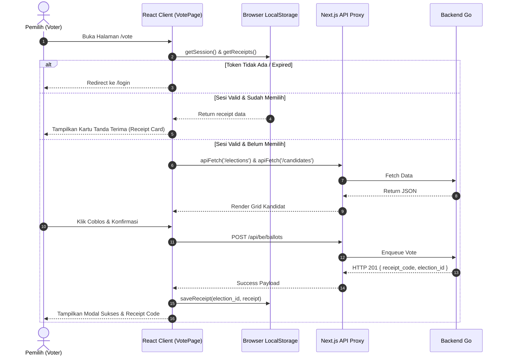

# Technical Architecture & Frontend Design - E-Voting Web

**Repositori**: `evoting-ika-smauctaf-frontend`  
**Cakupan**: Web Application, Next.js 15 App Router, UI Component Primitives, Reverse API Proxy, dan State Management.

---

## 1. Tumpukan Teknologi (Tech Stack)

| Komponen | Teknologi | Keterangan |
| :--- | :--- | :--- |
| **Framework Utama** | [Next.js 15 (App Router)](https://nextjs.org/) | Server & Client side rendering, dynamic routing |
| **Bahasa & Library** | TypeScript, React 18 | Tipe data ketat dan rendering komponen reaktif |
| **Styling & CSS** | [Tailwind CSS 3.4](https://tailwindcss.com/) | Utilitas CSS kelas utilitas, responsive design |
| **Primitif UI** | [Radix UI](https://www.radix-ui.com/) + [shadcn/ui](https://ui.shadcn.com/) | Komponen modular aksesibel (Dialog, Dropdown, Tabs, Button) |
| **Visualisasi Data** | [Recharts 2.15](https://recharts.org/) | Grafik batang & pie chart interaktif untuk admin |
| **Ikon Grafis** | [Lucide React](https://lucide.dev/) | Kumpulan ikon UI modern dan konsisten |
| **Notifikasi Toast** | [Sonner 2.0](https://sonner.emilkowal.ski/) | Sistem toast stackable, rich colors, dan performan |
| **Form & Validasi** | React Hook Form + Zod | Manajemen state form dan skema validasi deklaratif |

---

## 2. Arsitektur Proxy & Komunikasi Backend

Untuk menghindari isu Cross-Origin Resource Sharing (CORS) di browser dan menyembunyikan alamat internal REST API backend, frontend menggunakan pola **Internal Reverse Proxy**:

```mermaid
flowchart LR
    Browser["Browser Klien (Voter / Admin)"]
    Proxy["Next.js Route Handler (/api/be/*)"]
    Backend["Go REST API Server (:8080)"]

    Browser -- "1. apiFetch('/ballots')" --> Proxy
    Note over Proxy: Membaca EVOTING_API_URL<br/>Meneruskan Authorization & Body
    Proxy -- "2. POST http://backend:8080/api/ballots" --> Backend
    Backend -- "3. JSON Response Envelope" --> Proxy
    Proxy -- "4. Forward Respons ke Client" --> Browser
```

### Konfigurasi Reverse Proxy (`app/api/[[...path]]/route.ts`):
- Menangkap seluruh request dengan rute `/api/be/*`.
- Membaca environment variable `EVOTING_API_URL` (contoh: `http://localhost:8080/api`).
- Menyalin header `Authorization` (Bearer token JWT) dan meneruskan payload JSON.
- Menangani preflight `OPTIONS` dan header CORS secara transparan.

---

## 3. Struktur Direktori Proyek

```
├── app/                        # Next.js App Router
│   ├── api/                    # Route Handlers
│   │   └── [[...path]]/route.ts # Reverse proxy ke backend REST API
│   ├── admin/                  # Dashboard panel admin
│   │   ├── candidates/         # Manajemen calon ketua
│   │   ├── elections/          # Manajemen sesi pemilihan
│   │   ├── users/              # Manajemen akun pemilih
│   │   ├── results/            # Rekapitulasi suara & grafik
│   │   └── page.tsx            # Overview dashboard KPI
│   ├── login/                  # Halaman otentikasi login
│   ├── vote/                   # Halaman pemungutan suara & receipt
│   ├── globals.css             # Tailwind base & CSS theme variables
│   ├── layout.tsx              # Root HTML, font (Inter & Playfair), Sonner Toaster
│   └── page.tsx                # Halaman utama (Landing Page & Countdown)
├── components/                 # Komponen antarmuka
│   ├── ui/                     # shadcn/ui primitives (Button, Dialog, Card, Skeleton, dll.)
│   ├── admin/                  # Komponen khusus dashboard admin
│   └── Countdown.tsx           # Komponen hitung mundur waktu pemilihan
├── lib/                        # Helper & utilitas inti
│   ├── api.ts                  # Client fetcher (`apiFetch`), token JWT session, receipt helper
│   ├── utils.ts                # Utilitas merge Tailwind class (`cn` dengan clsx & twMerge)
│   └── constants/              # Label status, test IDs, metadata
├── public/                     # Asset statis, logo IKA SMAUCTAF, favicon
└── next.config.js              # Konfigurasi standalone build & header
```

---

## 4. Alur Manajemen Sesi & Penyimpanan Bukti Suara (*Session & Receipts*)



---

## 5. Konvensi Komponen & Standar Pengkodean

1. **Client Component Directive**:
   - Seluruh halaman interaktif yang menggunakan state React (`useState`, `useEffect`), event handler, atau akses DOM peramban (`localStorage`) wajib diawali dengan deklarasi `'use client'`.
2. **Pola Data Fetching**:
   - Gunakan wrapper `apiFetch` dari `@/lib/api` untuk memastikan header Authorization dan parsing response otomatis tertangani.
3. **Pemberitahuan Kesalahan Terpusat**:
   - Manfaatkan `toast.error(...)` atau `toast.success(...)` dari package `sonner` agar pengguna mendapatkan umpan balik visual yang jelas.
4. **Build Output**:
   - Konfigurasi `output: 'standalone'` pada `next.config.js` untuk menghasilkan binary build Node.js minimalis yang siap di-deploy via Docker container.
