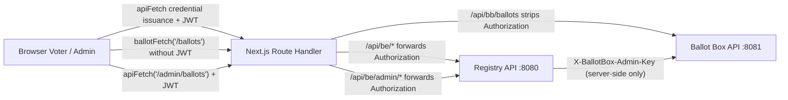

# Technical Architecture & Frontend Design - E-Voting Web

**Repositori**: `evoting-ika-smauctaf-frontend`  
**Cakupan**: Web Application, Next.js 15 App Router, dual reverse proxy ke Registry/Ballot Box, dan browser RSABSSA client.

---

## 1. Tumpukan Teknologi (Tech Stack)

| Komponen | Teknologi | Keterangan |
| :--- | :--- | :--- |
| **Framework Utama** | [Next.js 15 (App Router)](https://nextjs.org/) | Server & Client side rendering, dynamic routing |
| **Bahasa & Library** | TypeScript, React 18 | Tipe data ketat dan rendering komponen reaktif |
| **Styling & CSS** | [Tailwind CSS 3.4](https://tailwindcss.com/) | Utilitas CSS kelas utilitas, responsive design |
| **Primitif UI** | [Radix UI](https://www.radix-ui.com/) + [shadcn/ui](https://ui.shadcn.com/) | Komponen modular aksesibel (Dialog, Dropdown, Tabs, Button) |
| **Visualisasi Data** | [Recharts 2.15](https://recharts.org/) | Grafik batang & pie chart interaktif untuk admin |
| **Ikon Grafis** | [Lucide React](https://lucide.dev/) | Kumpulan ikon UI modern dan konsisten |
| **Notifikasi Toast** | [Sonner 2.0](https://sonner.emilkowal.ski/) | Sistem toast stackable, rich colors, dan performan |
| **Form & Validasi** | React Hook Form + Zod | Manajemen state form dan skema validasi deklaratif |
| **Blind Signature** | `@cloudflare/blindrsa-ts` 0.4.6 | RSABSSA-SHA384-PSS-Randomized RFC 9474 di browser |

---

## 2. Arsitektur Proxy & Komunikasi Backend

Untuk menghindari isu Cross-Origin Resource Sharing (CORS) di browser dan menyembunyikan alamat internal REST API backend, frontend menggunakan pola **Internal Reverse Proxy**:



### Konfigurasi Reverse Proxy (`app/api/[[...path]]/route.ts`):
- `/api/be/*` membaca `EVOTING_API_URL` dan meneruskan JWT untuk Registry.
- `/api/bb/*` membaca `EVOTING_BALLOTBOX_URL`; endpoint ballot publik tidak meneruskan header `Authorization`.
- Admin ballot/result queries memvalidasi JWT/RBAC di Registry; Registry memakai service key internal saat membaca Ballot Box.
- Proxy tidak mencatat payload voting; reverse proxy/APM produksi harus menonaktifkan access log korelatif.

---

## 3. Struktur Direktori Proyek

```
├── app/                        # Next.js App Router
│   ├── api/                    # Route Handlers
│   │   └── [[...path]]/route.ts # Reverse proxy ke backend REST API
│   ├── admin/                  # Dashboard panel admin
│   │   ├── candidates/         # Manajemen calon ketua
│   │   ├── elections/          # Manajemen sesi pemilihan
│   │   ├── users/              # Manajemen akun pemilih
│   │   ├── results/            # Rekapitulasi suara & grafik
│   │   └── page.tsx            # Overview dashboard KPI
│   ├── login/                  # Halaman otentikasi login
│   ├── vote/                   # Halaman pemungutan suara & receipt
│   ├── globals.css             # Tailwind base & CSS theme variables
│   ├── layout.tsx              # Root HTML, font (Inter & Playfair), Sonner Toaster
│   └── page.tsx                # Halaman utama (Landing Page & Countdown)
├── components/                 # Komponen antarmuka
│   ├── ui/                     # shadcn/ui primitives (Button, Dialog, Card, Skeleton, dll.)
│   ├── admin/                  # Komponen khusus dashboard admin
│   └── Countdown.tsx           # Komponen hitung mundur waktu pemilihan
├── lib/                        # Helper & utilitas inti
│   ├── api.ts                  # Registry/Box fetcher, token JWT session, receipt helper
│   ├── blind-vote.ts           # RSABSSA client, finalize/verify, persisted retry state
│   ├── utils.ts                # Utilitas merge Tailwind class (`cn` dengan clsx & twMerge)
│   └── constants/              # Label status, test IDs, metadata
├── public/                     # Asset statis, logo IKA SMAUCTAF, favicon
└── next.config.js              # Konfigurasi standalone build & header
```

---

## 4. Alur Manajemen Sesi & Penyimpanan Bukti Suara (*Session & Receipts*)

```mermaid
sequenceDiagram
    autonumber
    actor User as Pemilih (Voter)
    participant Client as React Client (VotePage)
    participant Storage as Browser LocalStorage
    participant Proxy as Next.js API Proxy
    participant Registry as Registry API
    participant Box as Ballot Box API

    User->>Client: Buka Halaman /vote
    Client->>Storage: getSession() & getReceipts()
    alt Token Tidak Ada / Expired
        Client-->>User: Redirect ke /login
    else Sesi Valid & Sudah Memilih
        Storage-->>Client: Return receipt data
        Client-->>User: Tampilkan Kartu Tanda Terima (Receipt Card)
    else Sesi Valid & Belum Memilih
        Client->>Proxy: apiFetch('/elections') & apiFetch('/candidates')
        Proxy->>Registry: GET metadata (JWT only where required)
        Registry-->>Proxy: Election/candidate metadata
        Proxy-->>Client: Render Grid Kandidat
        User->>Client: Klik Coblos & Konfirmasi
        Client->>Proxy: GET credential key (JWT)
        Proxy->>Registry: Validate voter and return signed key certificate
        Registry-->>Proxy: Certificate scoped to election/batch
        Proxy-->>Client: Certificate
        Client->>Client: Verify certificate; create/blind random credential
        Client->>Storage: Save blind state for identical retry
        Client->>Proxy: POST blinded credential (JWT)
        Proxy->>Registry: Issue blind signature
        Registry-->>Proxy: Blind signature
        Proxy-->>Client: Blind signature
        Client->>Client: Finalize and verify RSABSSA credential
        Client->>Proxy: POST anonymous ballot (NO JWT)
        Proxy->>Box: Forward without Authorization
        Box->>Box: Verify credential, candidate, signed catalog
        Box->>Box: Commit ballot + nullifier + receipt transaction
        Box-->>Proxy: HTTP 201 durable receipt
        Proxy-->>Client: Receipt payload
        Client->>Proxy: GET receipt verification (no JWT)
        Proxy->>Box: Verify receipt code
        Box-->>Client: Valid, election and received time only
        Client->>Storage: saveReceipt(election_id, receipt)
        Client-->>User: Tampilkan Modal Sukses & Receipt Code
    end
```

---

## 5. Konvensi Komponen & Standar Pengkodean

1. **Client Component Directive**:
   - Seluruh halaman interaktif yang menggunakan state React (`useState`, `useEffect`), event handler, atau akses DOM peramban (`localStorage`) wajib diawali dengan deklarasi `'use client'`.
2. **Pola Data Fetching**:
   - Gunakan wrapper `apiFetch` dari `@/lib/api` untuk memastikan header Authorization dan parsing response otomatis tertangani.
3. **Pemberitahuan Kesalahan Terpusat**:
   - Manfaatkan `toast.error(...)` atau `toast.success(...)` dari package `sonner` agar pengguna mendapatkan umpan balik visual yang jelas.
4. **Build Output**:
   - Konfigurasi `output: 'standalone'` pada `next.config.js` untuk menghasilkan binary build Node.js minimalis yang siap di-deploy via Docker container.
